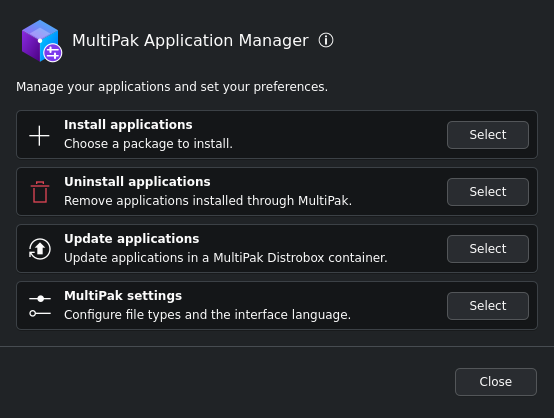
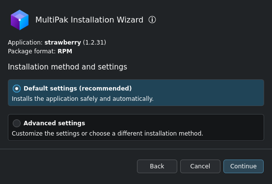
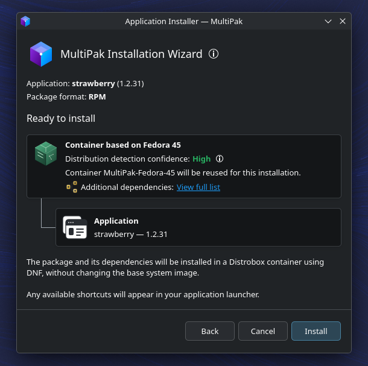

# MultiPak

Version: 1.0.0 Alpha 1

Author: Goulielmos. License: GNU GPLv3 (`GPL-3.0-only`).

MultiPak was developed to make installing different Linux package formats on Bazzite
easier and more consistent. It brings RPM, DEB, compiled Arch Linux packages and
AppImages together in a single graphical workflow, reducing the need to learn a
separate installation process for each format.

## Applications

MultiPak includes two applications:

- **MultiPak Installation Wizard** opens when you open a supported package file.
  It shows the package details and guides you through installation.
- **MultiPak Application Manager** opens from the application launcher. It lets
  you uninstall applications, update containers, choose file associations and
  set the interface language.

The wizard encourages users to check for a Flatpak version before continuing,
offering to open a search in Bazaar using the application's name.
If the user chooses to continue with the installation, MultiPak installs packages
and their dependencies inside Distrobox containers or integrates AppImages with
the desktop while preserving the base system image.

Direct RPM installation through rpm-ostree is
available as a last resort. Before proceeding, the wizard displays a warning
explaining the risks, including dependency conflicts and problems with future
system updates, and asks the user to confirm.

Both applications use Python, Qt and Kirigami controls that follow the KDE theme.

## Screenshots

### Application Manager


### Installation settings


### Installation summary


## Features

- Show package details before installation.
- Create standard or custom containers, or reuse one with a matching distribution and version.
- Install dependencies inside containers using DNF, APT or Pacman.
- Add application shortcuts, retry failed installations and clean up after cancellation.
- Uninstall applications, update containers and optionally remove a container after its last
  registered application is uninstalled.
- Choose file associations and the interface language.
- Install and remove RPM packages directly through rpm-ostree as a last resort.

Supported file types: `.rpm`, `.deb`, `.pkg.tar`, `.pkg.tar.zst`, `.pkg.tar.xz`,
`.pkg.tar.gz`, `.pkg.tar.bz2`, and `.AppImage` (type 1: ISO9660; type 2: SquashFS).

## Installation

MultiPak is distributed as a Flatpak package containing both the Installation Wizard and the Application Manager.

1. Download the `.flatpak` file.
2. Open the downloaded file with Bazaar.
3. Click **Install** and wait for installation to finish.
4. Open **MultiPak Application Manager** from your application launcher.

See [Distribution](docs/distribution.md) for build instructions and system requirements.

## FAQ

### Is MultiPak only for Bazzite?

MultiPak is currently developed and tested on Bazzite, but its core features
rely on tools available on other Linux distributions.

### Can it run on other Universal Blue distributions?

Container-based installation and AppImage integration are expected to work on
systems such as Bluefin and Aurora. These distributions will be tested soon.

### What about non-atomic distributions?

Container-based installation and AppImage integration should also work on these
systems, provided the required dependencies are available.

Direct RPM installation, however, is only available on systems that use rpm-ostree.

## Development requirements

For local development, run MultiPak on the host as your regular user, without sudo.

- Linux, Python 3.11+, and compatible system versions of PySide6 and Kirigami.
- Rootless Podman and Distrobox 1.8+ for container installations.
- `rpm` on the host to inspect RPM packages.
- `unsquashfs` to read type 2 AppImages; `7zz`, `7z` or `bsdtar` for type 1.
- A booted rpm-ostree system and a session polkit agent for direct RPM installation.

## Local development setup

From the project directory, run:

```bash
python3 scripts/install_local.py
```

The setup script creates a private Python runtime, registers the desktop launchers
and makes MultiPak the default handler for supported formats. It preserves other
file associations. Missing Python dependencies are installed from binary wheels.

Open MultiPak Application Manager from your application launcher, or run
`multipak-manager`. To install a package, double-click it in your file manager or
pass its path to the wizard:

```bash
~/.local/bin/multipak-installer /path/to/application.deb
~/.local/bin/multipak-installer /path/to/application.AppImage
```

## Installation notes

For Arch packages, MultiPak runs `pacman -Syu --noconfirm` before `pacman -U --noconfirm FILE`, which
also updates the other packages in the shared environment.

AppImages use a managed copy in
`$XDG_DATA_HOME/multipak/appimages/<id>/application.AppImage`. Uninstalling removes
that copy and its shortcuts, preserving the original download and personal data.

Uninstalling an application preserves its container by default. After the last
registered application is removed, the manager offers to delete the container if
MultiPak created it, whether standard or custom. Deletion also removes any packages
still in the container, including applications installed by other means that MultiPak
may not detect. The container's home folder is kept by default. A separate unchecked
option lets you delete it too, including saved data and settings, when MultiPak can
verify its managed location. Files in other internal folders are deleted with the
container. Base images and containers created outside MultiPak are kept.

Cancelling an unfinished installation can
remove an exclusive container created for that attempt. Distrobox is integrated
with the host and is not a security sandbox; install packages from sources you trust.

Direct RPM installation and removal use rpm-ostree. Changes to the booted system
take effect after a restart.

See [Package installation](docs/package-installation.md) for container selection,
AppImage extraction, direct RPM handling and cleanup behavior.

## Languages

The interface supports English and Brazilian Portuguese. In the manager, open
Language to follow the system language or select a language manually. Unsupported
system languages fall back to English.

The selection applies immediately to the manager and to installer processes opened
afterwards. See [Translation maintenance](docs/translations.md) for catalog and
preference details.

## Development checks

```bash
python3 -m venv .venv
.venv/bin/python -m pip install -e '.[dev]'
.venv/bin/python scripts/translations.py --template
.venv/bin/python -m ruff check .
.venv/bin/python -m ruff format --check .
QT_QPA_PLATFORM=offscreen .venv/bin/python -m pytest
.venv/bin/python -m build
```

Python 3.14+ reads Zstandard through the standard library. Earlier versions use
the `zstandard` dependency. CI covers Python 3.11, 3.13, 3.14 and 3.15.

Native interface checks need the system's matching Qt, PySide6 and Kirigami:

```bash
python3 src/multipak/kirigami/bootstrap.py --manager --preview
python3 checks/native_ui/verify_manager.py
python3 checks/native_ui/verify_languages.py
```

See [Native interface checks](checks/native_ui/README.md) for preview options and
[Distribution](docs/distribution.md) for Flatpak packaging and host integration.

Further documentation:

- [Architecture](docs/architecture.md)
- [Testing](docs/testing.md)
- [Interface editing](docs/interface.md)
- [Distribution](docs/distribution.md)

## License

MultiPak is licensed under the GNU General Public License v3.0 (`GPL-3.0-only`).
The full text is in `LICENSE`, with attribution in `NOTICE`. Dependencies and
third-party assets retain their own licenses.

## References

- [Distrobox](https://distrobox.it/)
- [Pacman](https://man.archlinux.org/man/pacman.8.en)
- [PKGINFO](https://man.archlinux.org/man/PKGINFO.5.en)
- [Bazzite software guidance](https://docs.bazzite.gg/Installing_and_Managing_Software/Flatpak/)
- [Bazzite rpm-ostree guidance](https://docs.bazzite.gg/Installing_and_Managing_Software/rpm-ostree/)
- [Desktop Entry Specification](https://specifications.freedesktop.org/desktop-entry/latest/)
