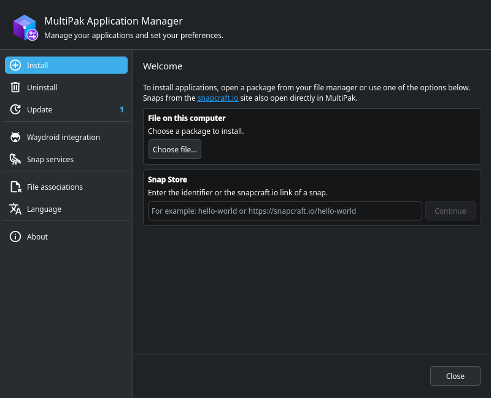
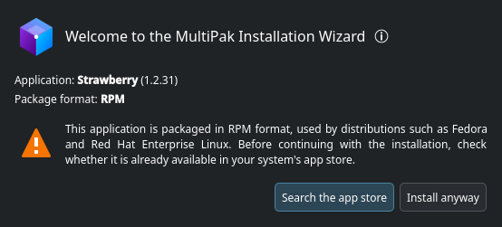
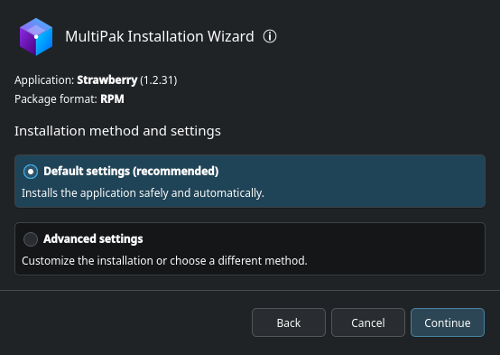
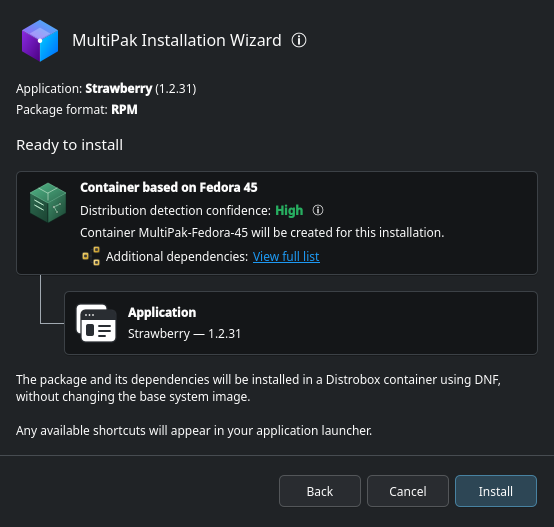
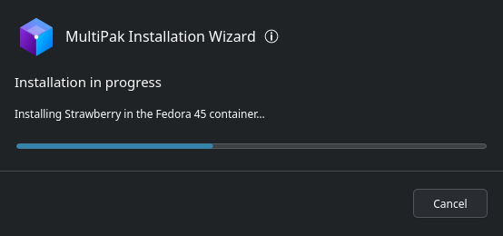
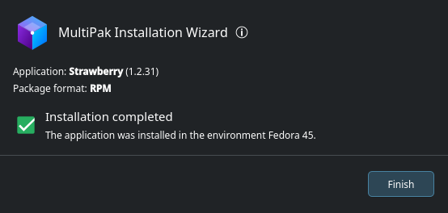

# MultiPak

**English** | [Português (Brasil)](README.pt-BR.md)

Version: 1.2.0 (in development)

Install packages made for other Linux distributions, and Android apps, on atomic systems,
without changing the base system.

Open a package file and the **Installation Wizard** takes care of it. The **Application
Manager**, in your application launcher, is where you update and uninstall applications,
manage the Waydroid integration and adjust MultiPak's settings.

## Features

- **Automatically installs distribution packages** and their dependencies in Distrobox
  containers. The supported distributions are in the table below.
- **Installs snaps without snapd**, from a file, a link or the Snap Store, background
  services included.
- **Runs AppImages**, even those that need libraries your system lacks.
- **Installs Android apps** in Android containers based on Waydroid, managed from the
  Waydroid integration.
- **Always up to date:** new distribution releases show up on their own, without a
  MultiPak update (except Slackware and Pisi Linux).
- **Shows everything before installing**: the application, the container and how sure
  MultiPak is about the choice.
- **Looks for a Flatpak alternative** in your app store (Bazaar, GNOME Software or KDE
  Discover) before you install.

### Supported packages

| Package | Extensions | How it works |
| --- | --- | --- |
| RPM (Fedora, Mageia, openSUSE, ALT Linux) | `.rpm` | [See how it works](docs/howrpmcompatibilityworks.md) |
| DEB (Debian, Ubuntu) | `.deb` | [See how it works](docs/howdebcompatibilityworks.md) |
| Arch Linux | `.pkg.tar`, `.pkg.tar.zst`, `.pkg.tar.xz`, `.pkg.tar.gz`, `.pkg.tar.bz2` | [See how it works](docs/howarchcompatibilityworks.md) |
| Alpine Linux | `.apk`\* | [See how it works](docs/howalpinecompatibilityworks.md) |
| Void Linux | `.xbps` | [See how it works](docs/howvoidcompatibilityworks.md) |
| Solus | `.eopkg` | [See how it works](docs/howsoluscompatibilityworks.md) |
| Slackware | `.txz`, `.tgz`, `.tar.xz`, `.tar.gz` | [See how it works](docs/howslackwarecompatibilityworks.md) |
| Gentoo | `.gpkg.tar` | [See how it works](docs/howgentoocompatibilityworks.md) |
| Pisi Linux | `.pisi` | [See how it works](docs/howpisicompatibilityworks.md) |
| SliTaz | `.tazpkg` | [See how it works](docs/howslitazcompatibilityworks.md) |
| Puppy Linux | `.pet` | [See how it works](docs/howpuppycompatibilityworks.md) |
| Snap | `.snap` | [See how this *miracle* works](docs/howsnapcompatibilityworks.md) |
| AppImage (types 1 and 2) | `.AppImage` | [See how it works](docs/howappimagecompatibilityworks.md) |
| Android | `.apk`\*, `.apkm`, `.apks`, `.xapk` | — |

\* Alpine packages and Android apps share the `.apk` extension; MultiPak tells them apart
by their contents.

## Screenshots

### Application Manager

### Installation Wizard

### Installation settings

### Installation summary

### Installation progress

### Installation completed

## Installation

MultiPak is a single Flatpak with both the Installation Wizard and the Application
Manager.

1. Download the `.flatpak` file from [Releases](https://github.com/goulielmos-linux/multipak/releases).
2. Open it with a Flatpak installer, such as Bazaar, Discover, GNOME Software or
   Warehouse, and click **Install**.

Or, in a terminal: `flatpak install --user multipak-1.2.0-x86_64.flatpak`

## Updates

Signed updates arrive through your app store, like any other Flatpak. MultiPak tells you
when a new version is out, and you can ask to be reminded later. A required security
update blocks new installations until MultiPak is updated; you can still see and
uninstall your applications.

## Compatibility

MultiPak focuses on Universal Blue (Bazzite, Aurora, and Bluefin) and Fedora
Atomic Desktops (Silverblue and Kinoite). MultiPak is developed on Bazzite and
tested on all of the distributions listed above.

MultiPak may also work on openSUSE (Kalpa and Aeon) and KDE Linux. Compatibility
with these distributions has yet to be tested.

Other Linux distributions, including non-atomic ones, may work if they have Distrobox 1.8
or later and rootless Podman. On rpm-ostree systems without Distrobox, MultiPak offers to
install it; this may ask for your password and needs a restart.

Direct RPM installation, without a container, is available only on rpm-ostree systems.

Snaps only need bubblewrap, which Flatpak already requires; snapd is not used. Before
installing a snap, MultiPak says what it cannot provide for it.

Android apps need Waydroid, a Wayland session, systemd and PolicyKit. MultiPak creates
its own Android 13 or Android 11 containers and never changes the system's Waydroid;
creating one asks for authorization and downloads Android images. Optional ARM
translation is available for Android 13 on x86_64.

## Important notes

- Install packages only from sources you trust. Distrobox containers and snaps share your
  home folder, devices and desktop session, so they are not a security sandbox.
- Android apps keep Android's own separation between apps and cannot see your home
  folder, but they share the network, display, sound and graphics card, and their
  container is started with system privileges, as with Waydroid.
- Direct RPM installation through rpm-ostree is a last resort: it can cause dependency
  conflicts, affect system updates and needs a restart.
- When you uninstall the last application of a container, MultiPak offers to delete the
  container. Its home folder is kept unless you choose otherwise.

## Documentation

- [Changelog](CHANGELOG.md)
- [Contributing](CONTRIBUTING.md)
- [Local development](docs/development.md)
- [Architecture](docs/architecture.md)

## Author and license

Made by [Goulielmos](https://github.com/goulielmos-linux). MultiPak is free software under
the GNU General Public License v3.0 (`GPL-3.0-only`); see [LICENSE](LICENSE). Third-party
components keep their own licenses, listed in [NOTICE](NOTICE).
