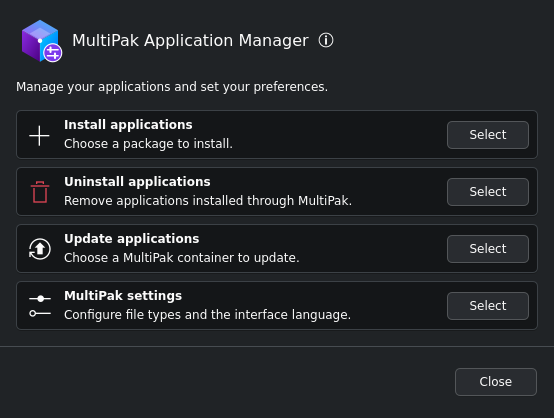
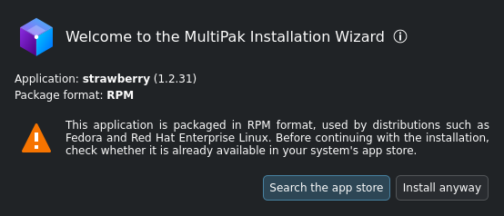
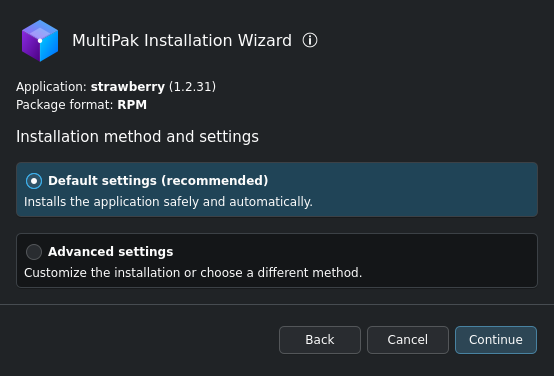
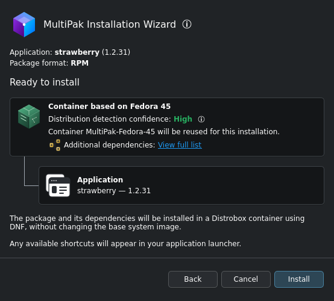
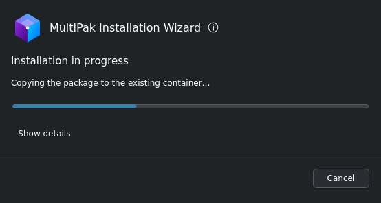
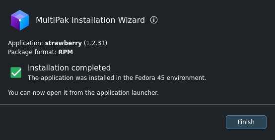

# MultiPak

Version: Unreleased

MultiPak makes installing different package formats on atomic Linux distributions
easier and more consistent, with a Kirigami interface that follows KDE’s design.

MultiPak includes an Installation Wizard, which opens package files, and an
Application Manager, available from the application launcher.

## Screenshots

### Application Manager

### Installation Wizard

### Installation settings

### Installation summary

### Installation progress

### Installation completed

## Features

- Review package details before installation.
- Install RPM, DEB and compiled Arch Linux packages with their dependencies inside
  Distrobox containers.
- Create a standard or custom container, or reuse a compatible existing one.
- Add AppImages to the application launcher while preserving the original download.
- Install Android applications (`.apk`, `.apkm`, `.apks` and `.xapk`) in separate
  Android containers based on Waydroid, and manage those containers from the
  Application Manager.
- Uninstall applications and update Distrobox containers.
- Show download progress when Podman or the package manager reports it.
- Search Bazaar, GNOME Software or KDE Discover for a Flatpak alternative before
  installing a non-native package.
- Configure file associations and choose the interface language: English, Brazilian
  Portuguese or the system language. Unsupported system languages fall back to English.

Supported files: `.rpm`, `.deb`, `.pkg.tar`, `.pkg.tar.zst`, `.pkg.tar.xz`,
`.pkg.tar.gz`, `.pkg.tar.bz2`, `.apk`, `.apkm`, `.apks`, `.xapk`, and type 1 or
type 2 `.AppImage` files.

## Installation

MultiPak is distributed as a Flatpak package containing both the Installation
Wizard and the Application Manager.

1. Download the `.flatpak` file from [Releases](https://github.com/goulielmos-linux/multipak/releases).
2. Open the downloaded file with Bazaar or another Flatpak bundle installer.
3. Click **Install** and wait for installation to finish.
4. Open a supported package file with MultiPak to start the Installation Wizard.
5. To install or uninstall applications or change preferences, open **MultiPak
   Application Manager** from the application launcher.

## Updates

Signed updates are delivered through the system's software store. MultiPak shows
update notices in the manager and installer, with an option to remind you in
24 hours. A required security update blocks new application installations until
MultiPak is updated; viewing and uninstalling applications remain available.

## Compatibility

MultiPak focuses on Universal Blue (Bazzite, Aurora, and Bluefin) and Fedora
Atomic Desktops (Silverblue and Kinoite). MultiPak is developed on Bazzite and
tested on all of the distributions listed above.

MultiPak may also work on openSUSE (Kalpa and Aeon) and KDE Linux. Compatibility
with these distributions has yet to be tested.

It may work on other Linux distributions, including non-atomic
systems, provided the required dependencies are available. Container installations
require Distrobox 1.8+ and rootless Podman. The Flatpak includes the RPM inspection
tool; native development requires `rpm` on the host.

If Distrobox is missing on an rpm-ostree system, MultiPak offers to install it with
system authorization and a restart. Reopen the package after restarting to
continue.

Direct RPM installation is available only on systems using rpm-ostree.

Android installation requires Waydroid on the host, a Wayland session, systemd and
PolicyKit. MultiPak creates named Android containers with a bundled, adapted
Waydroid runtime; installation settings choose Android 13 or Android 11 and a new or
existing container. The system Waydroid installation remains available as a separate
option and is not modified by these containers. Creating a container requests system
authorization and downloads Android images. Unencrypted APKM bundles are supported.
Automatic ARM translation setup is optional and currently supports Android 13 on
x86_64.

## Important notes

- Install packages from sources you trust. Distrobox integrates with the host and
  is not a security sandbox.
- Direct RPM installation through rpm-ostree is a last resort. It requires explicit
  confirmation, can cause dependency conflicts or affect system updates, and
  requires a restart for changes to take effect.
- Removing the last registered application can offer to delete its MultiPak
  container. The container's home folder is kept unless you choose to delete it.

## Documentation

- [Changelog](CHANGELOG.md)
- [Local development](docs/development.md)
- [Architecture](docs/architecture.md)

## Author and license

Author: [Goulielmos](https://github.com/goulielmos-linux).

MultiPak is licensed under the GNU General Public License v3.0 (`GPL-3.0-only`).
See [LICENSE](LICENSE) and [NOTICE](NOTICE) for the license and attribution.
Dependencies and third-party assets retain their own licenses.
