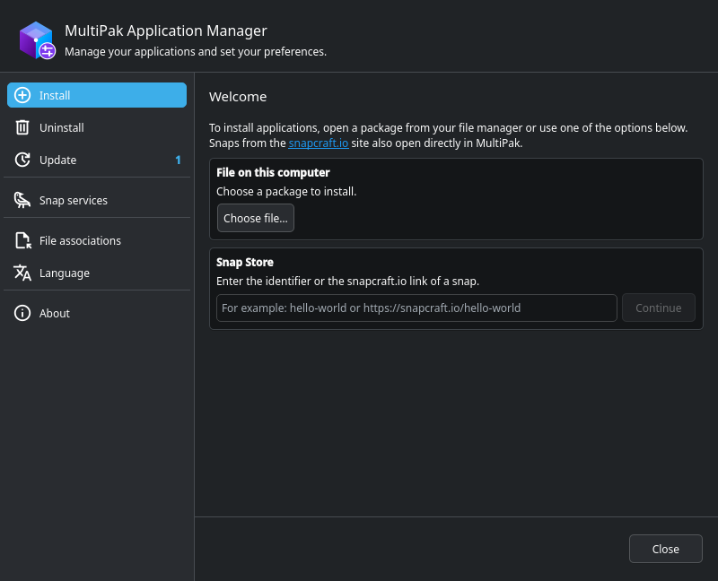
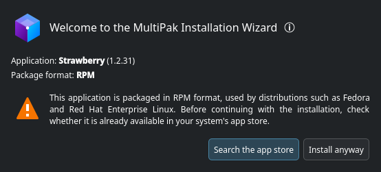
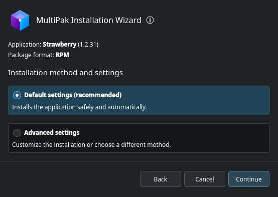
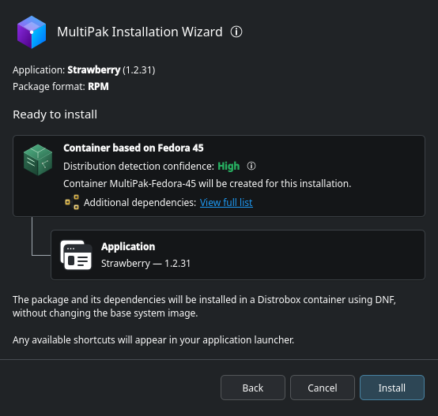
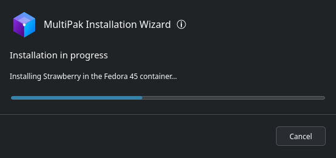
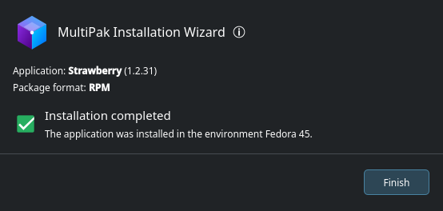

# MultiPak

[English](README.md) | **Português (Brasil)**

Versão: 1.1.0

Instale pacotes feitos para outras distribuições Linux em sistemas atômicos, sem
alterar o sistema base.

Abra um arquivo de pacote e o **Assistente de Instalação** cuida do resto. O **Gerenciador de
Aplicativos**, no lançador de aplicativos, é onde você atualiza e desinstala aplicativos
e ajusta as configurações do MultiPak.

## Recursos

- **Pacotes Linux**, instalados com suas dependências em contêineres Distrobox:
  - RPM do Fedora, Mageia, openSUSE e ALT Linux.
    [Veja como funciona.](docs/howrpmenvironmentsworks.pt-BR.md)
  - DEB e Arch Linux.
  - Alpine Linux. [Veja como funciona.](docs/howalpinecompatibilityworks.pt-BR.md)
  - Void Linux. [Veja como funciona.](docs/howvoidcompatibilityworks.pt-BR.md)
  - Solus. [Veja como funciona.](docs/howsoluscompatibilityworks.pt-BR.md)
  - Slackware. [Veja como funciona.](docs/howslackwarecompatibilityworks.pt-BR.md)
  - Gentoo. [Veja como funciona.](docs/howgentoocompatibilityworks.pt-BR.md)
  - Pisi Linux. [Veja como funciona.](docs/howpisicompatibilityworks.pt-BR.md)
  - SliTaz. [Veja como funciona.](docs/howslitazcompatibilityworks.pt-BR.md)
  - Puppy Linux. [Veja como funciona.](docs/howpuppycompatibilityworks.pt-BR.md)
- **Sempre atualizado:** as novas versões de cada distribuição aparecem no MultiPak sozinhas,
  sem precisar atualizá-lo. As exceções são o Slackware e o Pisi Linux, cuja versão suportada
  é definida no MultiPak.
- **AppImages** que precisam de bibliotecas que faltam no seu sistema funcionam mesmo assim: o
  MultiPak descobre o que falta antes da primeira execução e providencia num contêiner
  compartilhado. [Veja como funciona.](docs/howappimagecompatibilityworks.pt-BR.md)
- **Snaps** são instalados sem o snapd, a partir de um arquivo, de um link ou da Snap Store,
  com serviços em segundo plano incluídos. [Veja como esse milagre funciona.](docs/howsnapcompatibilityworks.pt-BR.md)
- **Revisão antes de instalar**, com uma busca na sua loja de aplicativos (Bazaar, GNOME Software
  ou KDE Discover) por uma alternativa em Flatpak.
- **Atualizações por aplicativo:** veja quais têm versão nova e atualize um por um ou todos de
  uma vez. Um aplicativo em contêiner é atualizado junto com o contêiner.
- **Contêineres do seu jeito:** padrão, personalizado ou um já existente que você reaproveita.
- **Configurações** de associação de arquivos e do idioma da interface (inglês ou português do
  Brasil).

Arquivos suportados: `.rpm`, `.deb`, `.pkg.tar`, `.pkg.tar.zst`, `.pkg.tar.xz`,
`.pkg.tar.gz`, `.pkg.tar.bz2`, pacotes do Slackware `.txz`, `.tgz`, `.tar.xz` e `.tar.gz`,
pacotes do Pisi Linux `.pisi`, do SliTaz `.tazpkg`, do Gentoo `.gpkg.tar`, do Puppy Linux
`.pet`, do Alpine Linux `.apk`, do Void Linux `.xbps` e do Solus `.eopkg`,
arquivos `.AppImage` dos tipos 1 e 2 e arquivos `.snap`.

## Capturas de tela

### Gerenciador de Aplicativos

### Assistente de Instalação

### Configurações da instalação

### Resumo da instalação

### Instalação em andamento

### Instalação concluída

## Instalação

O MultiPak é um único Flatpak, com o Assistente de Instalação e o Gerenciador de Aplicativos.

1. Baixe o arquivo `.flatpak` em [Releases](https://github.com/goulielmos-linux/multipak/releases).
2. Abra-o com um instalador de Flatpak, como Bazaar, Discover, GNOME Software ou Warehouse,
   e clique em **Instalar**.

Ou, no terminal: `flatpak install --user multipak-1.1.0-x86_64.flatpak`

## Atualizações

As atualizações assinadas chegam pela sua loja de aplicativos, como em qualquer outro
Flatpak. O MultiPak avisa quando sai uma versão nova, e você pode pedir para ser lembrado
depois. Uma atualização de segurança obrigatória bloqueia novas instalações até o MultiPak
ser atualizado; você ainda pode ver e desinstalar seus aplicativos.

## Compatibilidade

O MultiPak é voltado ao Universal Blue (Bazzite, Aurora e Bluefin) e aos Fedora Atomic
Desktops (Silverblue e Kinoite). Ele é desenvolvido no Bazzite e testado em todas essas
distribuições.

O MultiPak também pode funcionar no openSUSE (Kalpa e Aeon) e no KDE Linux. A compatibilidade
com essas distribuições ainda não foi testada.

Outras distribuições Linux, inclusive as não atômicas, podem funcionar se tiverem o Distrobox
1.8 ou mais recente e o Podman sem root. Em sistemas rpm-ostree sem o Distrobox, o MultiPak
oferece instalá-lo; isso pode pedir sua senha e exige reiniciar.

A instalação direta de RPM, sem contêiner, só está disponível em sistemas rpm-ostree.

Os snaps só precisam do bubblewrap, que o Flatpak já exige; o snapd não é usado. Antes de
instalar um snap, o MultiPak informa o que não consegue oferecer a ele.

## Avisos importantes

- Instale pacotes apenas de fontes em que você confia. Os contêineres Distrobox e os snaps
  compartilham sua pasta pessoal, seus dispositivos e sua sessão, então não são uma área
  isolada de segurança.
- A instalação direta de RPM pelo rpm-ostree é o último recurso: pode causar conflitos de
  dependências, afetar as atualizações do sistema e exige reiniciar.
- Quando você desinstala o último aplicativo de um contêiner, o MultiPak oferece apagar o
  contêiner. A pasta pessoal dele é mantida, a menos que você escolha o contrário.

## Documentação

Estes documentos estão em inglês.

- [Registro de mudanças](CHANGELOG.md)
- [Como contribuir](CONTRIBUTING.md)
- [Desenvolvimento local](docs/development.md)
- [Arquitetura](docs/architecture.md)

## Autor e licença

Feito por [Goulielmos](https://github.com/goulielmos-linux). O MultiPak é software livre,
sob a GNU General Public License v3.0 (`GPL-3.0-only`); veja [LICENSE](LICENSE). Componentes
de terceiros mantêm suas próprias licenças, listadas em [NOTICE](NOTICE).
