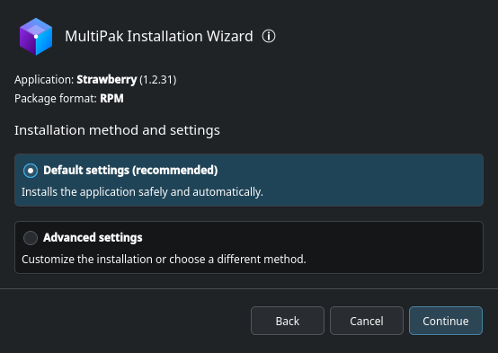

# MultiPak 1.2.0

[English](README.md) | **Português (Brasil)**

*Em desenvolvimento.*

O **MultiPak** é uma ferramenta gráfica para sistemas Linux atômicos que instala pacotes
em múltiplos formatos sem alterar o sistema base.

Apenas abra um arquivo de pacote e o **Assistente de Instalação** cuida do resto. Para
atualizar ou desinstalar aplicativos, gerenciar a Integração Waydroid e ajustar as
configurações do MultiPak, acesse o **Gerenciador de Aplicativos** no seu lançador.

## Recursos

- **Instala automaticamente pacotes de distribuições** e suas dependências em
  contêineres Distrobox. As distribuições suportadas estão na tabela abaixo.
- **Instala snaps sem o snapd**, a partir de um arquivo, de um link ou da Snap Store,
  com serviços em segundo plano incluídos.
- **Roda AppImages**, mesmo os que precisam de bibliotecas que faltam no seu sistema.
- **Instala aplicativos Android** em contêineres Android baseados no Waydroid,
  gerenciados pela Integração Waydroid.
- **Sempre atualizado:** novas versões das distribuições aparecem sozinhas, sem precisar
  atualizar o MultiPak (exceto Slackware e Pisi Linux).
- **Mostra tudo antes de instalar**: o aplicativo, o contêiner e quão seguro o MultiPak
  está da escolha.
- **Procura uma alternativa em Flatpak** na sua loja de aplicativos (Bazaar, GNOME
  Software ou KDE Discover) antes de instalar.

### Pacotes suportados

| Pacote | Extensões | Como funciona |
| :---: | :---: | :---: |
| RPM (Fedora, Mageia, openSUSE, ALT Linux) | `.rpm` | [↗](docs/howrpmcompatibilityworks.pt-BR.md) |
| DEB (Debian, Ubuntu) | `.deb` | [↗](docs/howdebcompatibilityworks.pt-BR.md) |
| Arch Linux | `.pkg.tar`, `.pkg.tar.zst`, `.pkg.tar.xz`, `.pkg.tar.gz`, `.pkg.tar.bz2` | [↗](docs/howarchcompatibilityworks.pt-BR.md) |
| Alpine Linux | `.apk`\* | [↗](docs/howalpinecompatibilityworks.pt-BR.md) |
| Void Linux | `.xbps` | [↗](docs/howvoidcompatibilityworks.pt-BR.md) |
| Solus | `.eopkg` | [↗](docs/howsoluscompatibilityworks.pt-BR.md) |
| Slackware | `.txz`, `.tgz`, `.tar.xz`, `.tar.gz` | [↗](docs/howslackwarecompatibilityworks.pt-BR.md) |
| Gentoo | `.gpkg.tar` | [↗](docs/howgentoocompatibilityworks.pt-BR.md) |
| Pisi Linux | `.pisi` | [↗](docs/howpisicompatibilityworks.pt-BR.md) |
| SliTaz | `.tazpkg` | [↗](docs/howslitazcompatibilityworks.pt-BR.md) |
| Puppy Linux | `.pet` | [↗](docs/howpuppycompatibilityworks.pt-BR.md) |
| Snap | `.snap` | [↗](docs/howsnapcompatibilityworks.pt-BR.md) |
| AppImage (tipos 1 e 2) | `.AppImage` | [↗](docs/howappimagecompatibilityworks.pt-BR.md) |
| Android | `.apk`\*, `.apkm`, `.apks`, `.xapk` | — |

\* Pacotes do Alpine e aplicativos Android usam a mesma extensão `.apk`; o MultiPak os
diferencia pelo conteúdo.

## Capturas de tela

### Gerenciador de Aplicativos

### Assistente de Instalação

### Configurações da instalação

### Resumo da instalação

### Instalação em andamento

### Instalação concluída

## Instalação

O MultiPak é um único Flatpak, com o Assistente de Instalação e o Gerenciador de Aplicativos.

1. Baixe o arquivo `.flatpak` em [Releases](https://github.com/goulielmos-linux/multipak/releases).
2. Abra-o com um instalador de Flatpak, como Bazaar, Discover, GNOME Software ou Warehouse,
   e clique em **Instalar**.

Ou, no terminal: `flatpak install --user multipak-1.2.0-x86_64.flatpak`

## Atualizações

As atualizações assinadas chegam pela sua loja de aplicativos, como em qualquer outro
Flatpak. O MultiPak avisa quando sai uma versão nova, e você pode pedir para ser lembrado
depois. Uma atualização de segurança obrigatória bloqueia novas instalações até o MultiPak
ser atualizado; você ainda pode ver e desinstalar seus aplicativos.

## Compatibilidade

O MultiPak é voltado ao Universal Blue (Bazzite, Aurora e Bluefin) e aos Fedora Atomic
Desktops (Silverblue e Kinoite). É desenvolvido no Bazzite e testado em todas essas
distribuições. Também pode funcionar no openSUSE (Kalpa e Aeon) e no KDE Linux, mas
ainda não foi testado nelas.

Outras distribuições Linux, inclusive as não atômicas, podem funcionar se tiverem o Distrobox
1.8 ou mais recente e o Podman sem root. Em sistemas rpm-ostree sem o Distrobox, o MultiPak
oferece instalá-lo; isso pode pedir sua senha e exige reiniciar.

A instalação direta de RPM, sem contêiner, só está disponível em sistemas rpm-ostree.

Os snaps só precisam do bubblewrap, que o Flatpak já exige; o snapd não é usado. Antes de
instalar um snap, o MultiPak informa o que não consegue oferecer a ele.

Os aplicativos Android precisam do Waydroid, de uma sessão Wayland, do systemd e do PolicyKit.
O MultiPak cria os próprios contêineres Android 13 ou Android 11 e nunca altera o Waydroid do
sistema; criar um contêiner pede autorização e baixa as imagens do Android. A tradução ARM
opcional está disponível para o Android 13 em x86_64.

## Avisos importantes

- Instale pacotes apenas de fontes em que você confia. Os contêineres Distrobox e os snaps
  compartilham sua pasta pessoal, seus dispositivos e sua sessão, então não são uma área
  isolada de segurança.
- Os aplicativos Android mantêm a separação entre aplicativos do próprio Android e não
  enxergam sua pasta pessoal, mas compartilham a rede, a tela, o som e a placa de vídeo, e o
  contêiner deles é iniciado com privilégios de sistema, como no Waydroid.
- A instalação direta de RPM pelo rpm-ostree é o último recurso: pode causar conflitos de
  dependências, afetar as atualizações do sistema e exige reiniciar.
- Quando você desinstala o último aplicativo de um contêiner, o MultiPak oferece apagar o
  contêiner. A pasta pessoal dele é mantida, a menos que você escolha o contrário.

## Documentação

Estes documentos estão em inglês.

- [Registro de mudanças](CHANGELOG.md)
- [Como contribuir](CONTRIBUTING.md)
- [Desenvolvimento local](docs/development.md)
- [Arquitetura](docs/architecture.md)

## Licença

O MultiPak é licenciado sob a `GPL-3.0-only`. Componentes de terceiros mantêm as próprias licenças.

Veja [LICENSE](LICENSE) e [NOTICE](NOTICE) para a licença e as atribuições.
